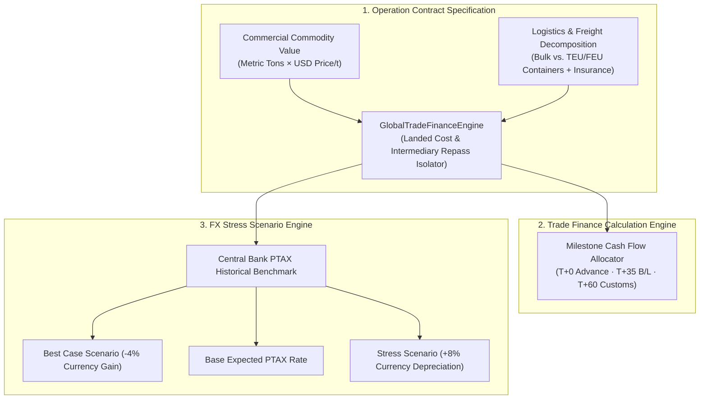

# 🌐 GlobalTrade FX Risk Simulator
### *Multi-Tier Maritime Import Trade Finance Cash Flow Engine & USD/BRL Currency Volatility Simulator*

[](https://www.typescriptlang.org/)
[](https://nodejs.org/)
[]()
[]()
[]()

---

## 📌 Executive Summary

International commodity imports (industrial minerals, alloys, chemicals) operate on multi-million dollar cash flows spanning **60 to 90 days** between contract signing and warehouse arrival. During this period, procurement teams face two existential financial hazards:

1. **Foreign Exchange Shock (USD/BRL Volatility):** Unhedged contracts exposed to exchange rate spikes can wipe out commercial operating margins between Bill of Lading (B/L) issuance and customs clearance.
2. **Complex Multi-Tier Settlement Schedules:** Managing structured milestone payments (20% advance / 60% against shipping documents / 20% post-customs) across multiple supply chain intermediaries while isolating net commercial bases from logistics tariffs.

`GlobalTrade FX Risk Simulator` is an algorithmic trade finance engine designed to **decompose landed import costs, model milestone cash flows, and stress-test currency variance across historical PTAX scenarios**.

> 🔒 **Enterprise Sanitization Notice:**  
> This open-source implementation operates on **100% synthetic commercial transactions and benchmark rate curves**. No proprietary trade partner identities, banking credentials, or private contract numbers are included.

---

## 🏗️ Cash Flow & Settlement Topology



---

## 🔬 Core Financial Capabilities

1. **Clean Commercial Base Isolation:** Intermediary repass margins (e.g. 5%) are strictly calculated against net commercial commodity value, preventing double-counting on freight, demurrage, or port insurance.
2. **Container Equivalent Normalization:** Automatically converts mixed container fleets (20ft standard vs 40ft high cube) into standardized TEU equivalents.
3. **PTAX Volatility Stress-Testing:** Simulates total BRL cash outflow under base, favorable, and currency-shock (+8% depreciation) market conditions.

---

## 🚀 Quickstart

### 1. Build TypeScript Source
```bash
git clone https://github.com/wenderson-werneck/globaltrade-fx-risk-simulator.git
cd globaltrade-fx-risk-simulator

# Compile
npm run build
```

### 2. Run Automated Test Suite
```bash
node --test dist/**/*.test.js
```

*Test Execution:*
```text
✔ GlobalTradeFinanceEngine: correctly calculates landed cost and milestones (1.63ms)
✔ GlobalTradeFinanceEngine: computes stress PTAX currency exposure accurately (0.22ms)
ℹ tests 2
ℹ pass 2
ℹ fail 0
```

---

## 📂 Project Structure

```text
globaltrade-fx-risk-simulator/
├── src/
│   ├── types.ts               # Domain contracts (CargoMode, Incoterms, FXScenario)
│   ├── simulator.ts           # Landed cost engine & milestone scheduler
│   ├── simulator.test.ts      # Automated unit tests
│   └── index.ts               # Public library entrypoint
├── package.json               # Package configuration
├── tsconfig.json              # TypeScript strict configuration
└── README.md                  # Financial architecture documentation
```

---

## 👤 Author
**Wenderson Soares (Werneck)**  
*Analytics Engineer | Trade Finance & Quantitative Systems*  
[LinkedIn](https://www.linkedin.com/in/wendersonwerneck/) • [GitHub](https://github.com/wenderson-werneck)
